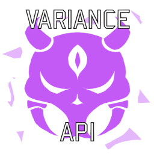
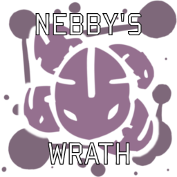
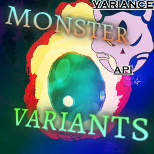

# VarianceAPI - API for creating CharacterVariants for Risk of Rain 2.

VarianceAPI is a complete rewrite of Rob's Monster Variants concept, alongside merging of the Monster Variants + addon features.

VarianceAPI allows the creation of CharacterVariantDefs, complex runtime modifiers that modify a character in real time.

## The purpose of this Github Repository

The Github Repository is used as the main front of the API, used for creating new issues as well for development of the project itself.

## Donations

VarianceAPI is a passion project from Nebby. as such, he works in his free time on this to allow the rest of the community to create new Variants

VarianceAPI will forever be free to use and never gated behind paywalls, however, donations are incredibly appreciated.

## Official Variant Packs

(Note: click the icon to open a new tab to the variant pack)
| Icon/URL | Name | Description |
|--|--|--|
|  | The Original 30 | The Original Thirty Variants developed by Rob, ported and modified to VarianceAPI. |
|  | Nebby's Wrath | 87 Variants spread across Base Game, Survivors of the Void, Seekers of the Storm and Alloyed Collective enemies. |

## Community Made Packs

(Note: click the icon to open a new tab to the variant pack)
| Icon/URL | Name | Description |
|--|--|--|
|  | Phreel's Variants | Some messed up enemy variants for vanilla and modded monsters alike. |
|  | HIFUVariants | HIFU's Monster and Boss Variants, revived for VarianceAPI 3.0.0 and Hallowed Concepts |

## Special Thanks

* KevinFromHPCustomerService for teaching me how to use Thunderkit way back in the day.
* IDeathHD and Harb, for making DebugToolkit and it's ``spawn_ai`` and ``spawn_as`` commands (used for ``vapi_spawn_ai`` and ``vapi_spawn_as`` commands)
* IDeathHD and Chinchi for general networking help
* Aaron, Gaforb, ``come on and SLAM``, EarthZebra and especially TheTimeSweeper ~~ly habibi~~ for helping me with networking issues.
* Aaron for helping with the creation of the WeightedSelection roll for unique variants
* Dotflare for making the Variance Artifact assets
* PassivePicasso for the development of Thunderkit
* Rob for creating Monster Variants.
* Papa zach for creating the Artifact & Expansion Icons
* Mackysoft for letting me use and redistribute his "SerializeReferenceExtensions" package.
* GrooveSalad for his ExpansionManager code, which was used as a base to create the variant rulebook categories
* MysticalChicken and Zenithrium for feedback regarding tokens